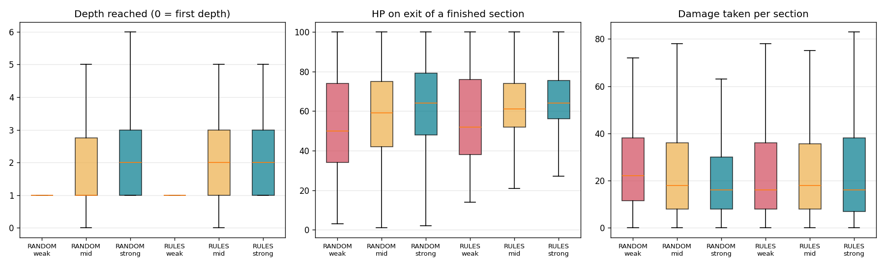
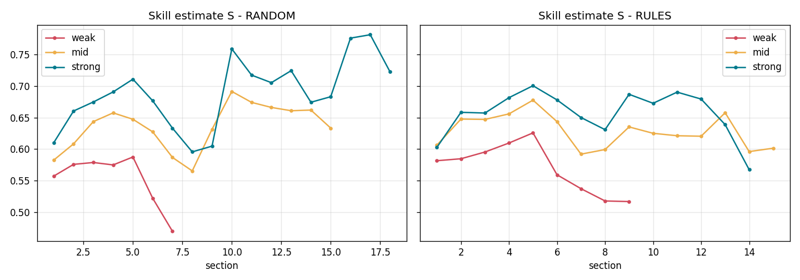
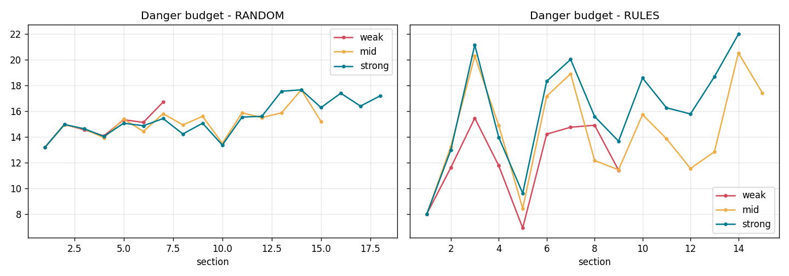
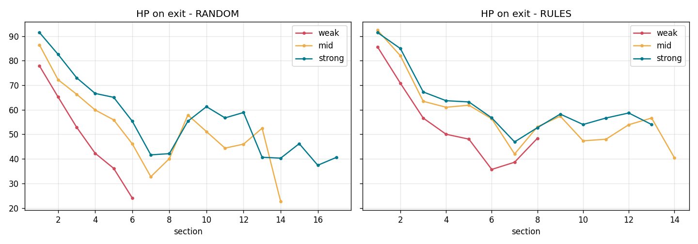

# Bot experiment

180 runs, 1656 sections. Death section counts from 1 (dying in the first section = 1).

| Mode | Bot | Runs | Sections cleared (mean) | Depth reached (mean) | Died | Death section: median (25-75%) | HP on exit (mean) | HP on exit, sections 1-6 | Sections in HP 30-70 | Damage per section (mean) | Damage spread in a run (std) | Skill S (run mean) |
| --- | --- | --- | --- | --- | --- | --- | --- | --- | --- | --- | --- | --- |
| RANDOM | weak | 30 | 5.0 | 1.9 | 100% | 6 (6-7) | 53 | 48 | 55% | 26.1 | 16.8 | 0.55 |
| RANDOM | mid | 30 | 8.0 | 2.8 | 100% | 8 (6-12) | 57 | 62 | 56% | 24.4 | 19.2 | 0.60 |
| RANDOM | strong | 30 | 10.0 | 3.4 | 100% | 9 (7-14) | 62 | 72 | 47% | 21.0 | 18.8 | 0.66 |
| RULES | weak | 30 | 6.5 | 2.3 | 100% | 7 (6-8) | 57 | 56 | 67% | 24.7 | 22.4 | 0.58 |
| RULES | mid | 30 | 9.6 | 3.0 | 100% | 10 (7-14) | 62 | 68 | 64% | 24.6 | 22.5 | 0.63 |
| RULES | strong | 30 | 10.1 | 3.2 | 100% | 10 (7-14) | 64 | 70 | 58% | 24.5 | 24.2 | 0.66 |

HP on exit counts finished sections only (not the one the bot died in); the sections 1-6 column counts a death there as HP 0, so it compares the same sections for every bot.

## Spread of HP on exit between bots

Smaller = the director keeps players of different skill closer to the same state.

| Mode | All finished sections: max - min of bot means | std | Sections 1-6: max - min | std |
| --- | --- | --- | --- | --- |
| RANDOM | 9.6 | 3.9 | 23.7 | 9.7 |
| RULES | 7.7 | 3.2 | 14.3 | 6.3 |

## Damage by source

Share of all damage taken; in brackets: in how many deaths this source dealt the most damage of the death section.

| Mode | Bot | archer | beetle | guardian | pit | skeleton | spikes |
| --- | --- | --- | --- | --- | --- | --- | --- |
| RANDOM | weak | 26% (1) | 20% (1) | 11% (12) | 19% (7) | 19% (6) | 5% (3) |
| RANDOM | mid | 40% (5) | 12% (2) | 20% (15) | 9% (5) | 16% (3) | 3% (0) |
| RANDOM | strong | 55% (15) | 7% (2) | 26% (12) | 4% (1) | 7% (0) | 1% (0) |
| RULES | weak | 23% (4) | 19% (0) | 19% (18) | 16% (7) | 19% (1) | 4% (0) |
| RULES | mid | 40% (7) | 13% (0) | 23% (21) | 6% (2) | 15% (0) | 3% (0) |
| RULES | strong | 55% (11) | 8% (1) | 24% (17) | 5% (1) | 6% (0) | 1% (0) |

## Figures

