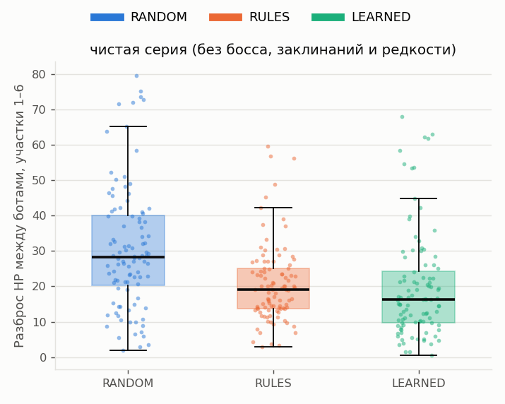
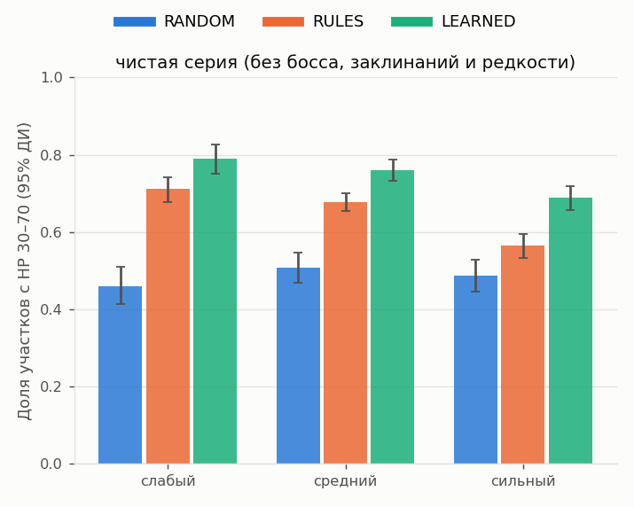
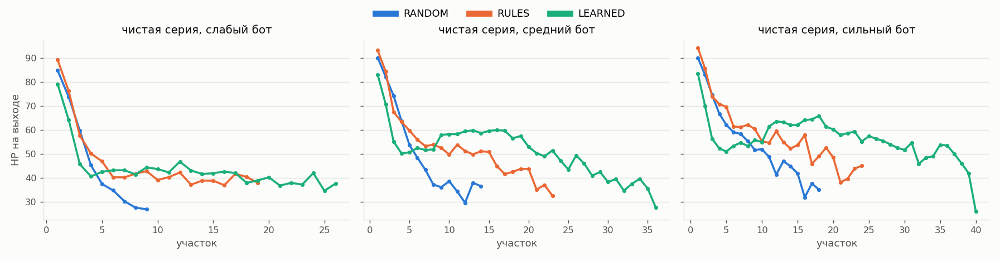
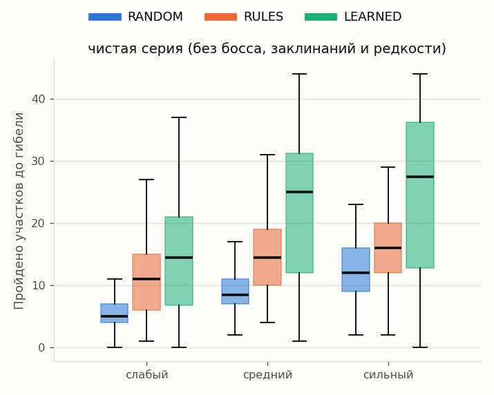
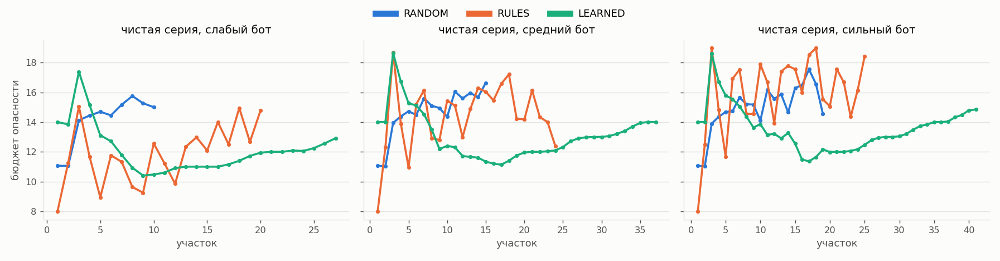
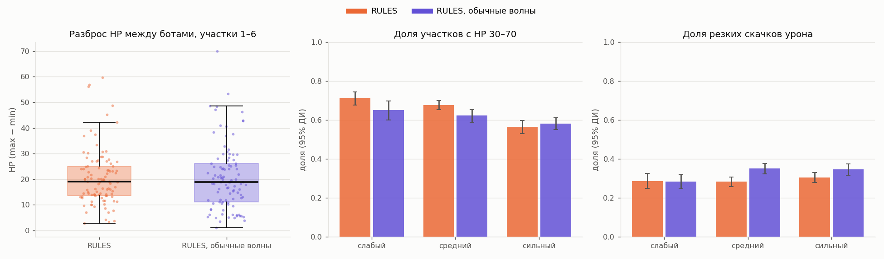

# Сравнение директоров на ботах

Логи: 1200 забегов, 18112 участков. Режимы: RANDOM, RULES, LEARNED; вариант: RULES с обычными волнами (пик ×1,3, отдых ×0,3). Сиды: 100 (5000–5099), одинаковые для всех режимов и ботов, поэтому сравнение парное: забеги разных режимов с одним сидом, ботом и серией сравниваются между собой.

**Как читать.** Для каждой метрики — среднее с 95% доверительным интервалом (бутстрэп, 5000 выборок), медианы, медиана парных разностей A − B. p — двусторонний парный критерий Уилкоксона; p (Холм) — с поправкой Холма внутри семейства сравнений серии: первичные метрики (гипотеза «сложно, но проходимо, ровно и близко для разных игроков»: разброс HP между ботами на участках 1–6, доля участков с HP 30–70, доля резких скачков) и вторичные (остальные, описательные); значимым считается p (Холм) < 0,05. r — размер эффекта (ранговая бисериальная корреляция, от −1 до 1; r > 0 — у A больше; |r| около 0,1 — малый, 0,3 — средний, 0,5 — большой). Незначимая разница не доказывает, что режимы одинаковы: она значит лишь, что данных не хватает, чтобы их различить.

Предел симуляции — 60 участков: забег, дошедший до него живым, обрывается; доля таких забегов — в таблице «Длина забегов и старт» каждой серии.

**RULES.** В плейтест идёт директор на правилах с мягкими волнами (пик ×1,15, отдых ×0,5). Поэтому в серии, где есть такие забеги, RULES — это мягкие волны, а обычные волны (пик ×1,3, отдых ×0,3) сравниваются с ними отдельно, в разделе «Вариант». В серии без забегов с мягкими волнами RULES — с обычными волнами (так настроена полная игра).

## Серия clean: чистая серия (без босса, заклинаний и редкости)

Забегов: 900 (RANDOM: 300, RULES: 300, LEARNED: 300).

### Главное

- Разброс HP между ботами, участки 1–6 (max − min) (все боты), RULES против RANDOM: у RULES ниже, разница значима после поправки Холма (p < 0,001), эффект большой (r = -0,51).
- Разброс HP между ботами, участки 1–6 (max − min) (все боты), LEARNED против RANDOM: у LEARNED ниже, разница значима после поправки Холма (p < 0,001), эффект средний (r = -0,49).
- Разброс HP между ботами, участки 1–6 (max − min) (все боты), LEARNED против RULES: значимой разницы нет (с поправкой Холма p = 0,435, r = -0,14).
- Доля участков с HP 30–70 (слабый бот), RULES против RANDOM: у RULES выше, разница значима после поправки Холма (p < 0,001), эффект большой (r = 0,81).
- Доля участков с HP 30–70 (слабый бот), LEARNED против RANDOM: у LEARNED выше, разница значима после поправки Холма (p < 0,001), эффект большой (r = 0,93).
- Доля участков с HP 30–70 (слабый бот), LEARNED против RULES: у LEARNED выше, разница значима после поправки Холма (p = 0,012), эффект средний (r = 0,38).
- Доля участков с HP 30–70 (средний бот), RULES против RANDOM: у RULES выше, разница значима после поправки Холма (p < 0,001), эффект большой (r = 0,68).
- Доля участков с HP 30–70 (средний бот), LEARNED против RANDOM: у LEARNED выше, разница значима после поправки Холма (p < 0,001), эффект большой (r = 0,85).
- Доля участков с HP 30–70 (средний бот), LEARNED против RULES: у LEARNED выше, разница значима после поправки Холма (p < 0,001), эффект большой (r = 0,53).
- Доля участков с HP 30–70 (сильный бот), RULES против RANDOM: у RULES выше, разница значима после поправки Холма (p = 0,022), эффект средний (r = 0,34).
- Доля участков с HP 30–70 (сильный бот), LEARNED против RANDOM: у LEARNED выше, разница значима после поправки Холма (p < 0,001), эффект большой (r = 0,71).
- Доля участков с HP 30–70 (сильный бот), LEARNED против RULES: у LEARNED выше, разница значима после поправки Холма (p < 0,001), эффект большой (r = 0,63).
- Доля резких скачков урона между соседними участками (слабый бот), RULES против RANDOM: у RULES выше, разница значима после поправки Холма (p = 0,008), эффект средний (r = 0,39).
- Доля резких скачков урона между соседними участками (слабый бот), LEARNED против RANDOM: значимой разницы нет (с поправкой Холма p = 0,533, r = 0,08).
- Доля резких скачков урона между соседними участками (слабый бот), LEARNED против RULES: значимой разницы нет (с поправкой Холма p = 0,431, r = -0,19).
- Доля резких скачков урона между соседними участками (средний бот), RULES против RANDOM: у RULES выше, разница значима после поправки Холма (p < 0,001), эффект большой (r = 0,51).
- Доля резких скачков урона между соседними участками (средний бот), LEARNED против RANDOM: значимой разницы нет (с поправкой Холма p = 0,431, r = 0,18).
- Доля резких скачков урона между соседними участками (средний бот), LEARNED против RULES: у LEARNED ниже, разница значима после поправки Холма (p = 0,004), эффект средний (r = -0,41).
- Доля резких скачков урона между соседними участками (сильный бот), RULES против RANDOM: у RULES выше, разница значима после поправки Холма (p < 0,001), эффект большой (r = 0,71).
- Доля резких скачков урона между соседними участками (сильный бот), LEARNED против RANDOM: у LEARNED выше, разница значима после поправки Холма (p < 0,001), эффект большой (r = 0,59).
- Доля резких скачков урона между соседними участками (сильный бот), LEARNED против RULES: значимой разницы нет (с поправкой Холма p = 0,308, r = -0,22).

### Разброс между ботами (по сидам)

| Метрика | Бот | Сравнение (A − B) | A: среднее [95% ДИ] | B: среднее [95% ДИ] | Медианы A / B | Медиана разностей [95% ДИ] | Пар | p | p (Холм) | r | Семейство |
| --- | --- | --- | --- | --- | --- | --- | --- | --- | --- | --- | --- |
| Разброс HP между ботами, участки 1–6 (max − min) | все | RULES − RANDOM | 20,7 [18,6; 22,8] | 30,7 [27,4; 34,2] | 19,2 / 28,3 | -9,8 [-13,2; -4,6] | 100 | < 0,001 | < 0,001 | -0,51 | первичная |
| Разброс HP между ботами, участки 1–6 (max − min) | все | LEARNED − RANDOM | 19,8 [17,0; 22,9] | 30,7 [27,4; 34,3] | 16,3 / 28,3 | -11,8 [-16,5; -8,2] | 100 | < 0,001 | < 0,001 | -0,49 | первичная |
| Разброс HP между ботами, участки 1–6 (max − min) | все | LEARNED − RULES | 19,8 [16,9; 22,9] | 20,7 [18,6; 22,8] | 16,3 / 19,2 | -1,8 [-5,5; 1,7] | 100 | 0,218 | 0,435 | -0,14 | первичная |
| Разброс HP между ботами, пройденные участки (max − min) | все | RULES − RANDOM | 17,3 [15,6; 19,1] | 18,5 [16,4; 20,5] | 16,5 / 16,5 | 1,2 [-2,1; 4,1] | 100 | 0,701 | 1,000 | -0,04 | вторичная |
| Разброс HP между ботами, пройденные участки (max − min) | все | LEARNED − RANDOM | 14,8 [13,0; 16,7] | 18,5 [16,5; 20,6] | 13,7 / 16,5 | -3,8 [-6,4; -0,9] | 100 | 0,010 | 0,147 | -0,30 | вторичная |
| Разброс HP между ботами, пройденные участки (max − min) | все | LEARNED − RULES | 14,8 [13,0; 16,8] | 17,3 [15,5; 19,1] | 13,7 / 16,5 | -0,8 [-4,9; 1,1] | 100 | 0,061 | 0,607 | -0,22 | вторичная |

### Метрики по ботам

| Метрика | Бот | Сравнение (A − B) | A: среднее [95% ДИ] | B: среднее [95% ДИ] | Медианы A / B | Медиана разностей [95% ДИ] | Пар | p | p (Холм) | r | Семейство |
| --- | --- | --- | --- | --- | --- | --- | --- | --- | --- | --- | --- |
| Доля участков с HP 30–70 | слабый | RULES − RANDOM | 0,707 [0,669; 0,739] | 0,460 [0,413; 0,509] | 0,750 / 0,429 | 0,269 [0,200; 0,327] | 95 | < 0,001 | < 0,001 | 0,81 | первичная |
| Доля участков с HP 30–70 | слабый | LEARNED − RANDOM | 0,801 [0,764; 0,834] | 0,447 [0,399; 0,495] | 0,852 / 0,429 | 0,360 [0,286; 0,456] | 90 | < 0,001 | < 0,001 | 0,93 | первичная |
| Доля участков с HP 30–70 | слабый | LEARNED − RULES | 0,791 [0,752; 0,826] | 0,729 [0,702; 0,756] | 0,846 / 0,750 | 0,097 [0,030; 0,131] | 95 | 0,002 | 0,012 | 0,38 | первичная |
| Доля участков с HP 30–70 | средний | RULES − RANDOM | 0,678 [0,654; 0,700] | 0,507 [0,468; 0,547] | 0,706 / 0,500 | 0,163 [0,111; 0,232] | 100 | < 0,001 | < 0,001 | 0,68 | первичная |
| Доля участков с HP 30–70 | средний | LEARNED − RANDOM | 0,761 [0,733; 0,787] | 0,507 [0,468; 0,547] | 0,787 / 0,500 | 0,250 [0,212; 0,298] | 100 | < 0,001 | < 0,001 | 0,85 | первичная |
| Доля участков с HP 30–70 | средний | LEARNED − RULES | 0,761 [0,733; 0,786] | 0,678 [0,654; 0,701] | 0,787 / 0,706 | 0,072 [0,055; 0,111] | 100 | < 0,001 | < 0,001 | 0,53 | первичная |
| Доля участков с HP 30–70 | сильный | RULES − RANDOM | 0,565 [0,532; 0,596] | 0,487 [0,446; 0,527] | 0,600 / 0,500 | 0,079 [0,029; 0,126] | 100 | 0,004 | 0,022 | 0,34 | первичная |
| Доля участков с HP 30–70 | сильный | LEARNED − RANDOM | 0,689 [0,656; 0,720] | 0,488 [0,448; 0,527] | 0,729 / 0,500 | 0,227 [0,188; 0,254] | 98 | < 0,001 | < 0,001 | 0,71 | первичная |
| Доля участков с HP 30–70 | сильный | LEARNED − RULES | 0,689 [0,656; 0,719] | 0,570 [0,539; 0,598] | 0,729 / 0,600 | 0,130 [0,088; 0,155] | 98 | < 0,001 | < 0,001 | 0,63 | первичная |
| HP на выходе, среднее по пройденным участкам | слабый | RULES − RANDOM | 54,3 [52,4; 56,5] | 56,1 [53,5; 58,7] | 52,0 / 55,3 | -1,2 [-4,8; 0,5] | 95 | 0,187 | 0,935 | -0,16 | вторичная |
| HP на выходе, среднее по пройденным участкам | слабый | LEARNED − RANDOM | 48,9 [47,2; 50,8] | 55,9 [53,3; 58,4] | 47,6 / 55,3 | -7,3 [-11,0; -2,9] | 90 | < 0,001 | < 0,001 | -0,50 | вторичная |
| HP на выходе, среднее по пройденным участкам | слабый | LEARNED − RULES | 48,4 [46,6; 50,4] | 53,2 [51,5; 55,0] | 47,0 / 51,3 | -4,7 [-6,1; -2,1] | 95 | < 0,001 | 0,003 | -0,45 | вторичная |
| HP на выходе, среднее по пройденным участкам | средний | RULES − RANDOM | 60,0 [58,6; 61,3] | 59,3 [57,2; 61,6] | 59,9 / 56,6 | 1,4 [-2,1; 5,4] | 100 | 0,382 | 1,000 | 0,10 | вторичная |
| HP на выходе, среднее по пройденным участкам | средний | LEARNED − RANDOM | 56,8 [55,6; 58,2] | 59,3 [57,2; 61,6] | 55,9 / 56,6 | -2,0 [-3,8; 1,0] | 100 | 0,133 | 0,913 | -0,17 | вторичная |
| HP на выходе, среднее по пройденным участкам | средний | LEARNED − RULES | 56,8 [55,6; 58,2] | 60,0 [58,6; 61,3] | 55,9 / 59,9 | -3,5 [-5,4; -1,7] | 100 | 0,001 | 0,025 | -0,37 | вторичная |
| HP на выходе, среднее по пройденным участкам | сильный | RULES − RANDOM | 65,2 [63,6; 66,9] | 61,4 [59,2; 63,5] | 63,8 / 61,1 | 3,1 [0,8; 6,9] | 100 | 0,003 | 0,046 | 0,34 | вторичная |
| HP на выходе, среднее по пройденным участкам | сильный | LEARNED − RANDOM | 60,0 [58,7; 61,5] | 61,3 [59,1; 63,6] | 58,8 / 61,1 | -2,3 [-4,7; 0,4] | 98 | 0,267 | 1,000 | -0,13 | вторичная |
| HP на выходе, среднее по пройденным участкам | сильный | LEARNED − RULES | 60,0 [58,7; 61,4] | 64,8 [63,3; 66,3] | 58,8 / 63,5 | -5,3 [-7,8; -2,9] | 98 | < 0,001 | < 0,001 | -0,57 | вторичная |
| HP на выходе, участки 1–6 (гибель = 0) | слабый | RULES − RANDOM | 57,1 [55,0; 59,0] | 47,0 [43,2; 50,7] | 58,2 / 48,0 | 9,0 [4,3; 12,8] | 100 | < 0,001 | < 0,001 | 0,50 | вторичная |
| HP на выходе, участки 1–6 (гибель = 0) | слабый | LEARNED − RANDOM | 47,1 [44,1; 49,8] | 47,0 [43,1; 50,8] | 50,4 / 48,0 | 1,7 [-4,6; 7,2] | 100 | 0,948 | 1,000 | 0,01 | вторичная |
| HP на выходе, участки 1–6 (гибель = 0) | слабый | LEARNED − RULES | 47,1 [44,2; 49,9] | 57,1 [55,0; 59,1] | 50,4 / 58,2 | -7,4 [-11,2; -5,3] | 100 | < 0,001 | < 0,001 | -0,76 | вторичная |
| HP на выходе, участки 1–6 (гибель = 0) | средний | RULES − RANDOM | 70,3 [69,1; 71,5] | 66,9 [64,3; 69,4] | 70,4 / 68,0 | 2,4 [0,3; 4,2] | 100 | 0,036 | 0,431 | 0,24 | вторичная |
| HP на выходе, участки 1–6 (гибель = 0) | средний | LEARNED − RANDOM | 57,3 [55,1; 59,4] | 66,9 [64,5; 69,5] | 58,9 / 68,0 | -8,8 [-13,1; -5,5] | 100 | < 0,001 | < 0,001 | -0,54 | вторичная |
| HP на выходе, участки 1–6 (гибель = 0) | средний | LEARNED − RULES | 57,3 [55,0; 59,4] | 70,3 [69,0; 71,5] | 58,9 / 70,4 | -12,2 [-14,8; -10,0] | 100 | < 0,001 | < 0,001 | -0,88 | вторичная |
| HP на выходе, участки 1–6 (гибель = 0) | сильный | RULES − RANDOM | 74,6 [72,8; 76,1] | 71,0 [68,3; 73,6] | 75,2 / 72,1 | 2,2 [-1,7; 7,8] | 100 | 0,045 | 0,497 | 0,23 | вторичная |
| HP на выходе, участки 1–6 (гибель = 0) | сильный | LEARNED − RANDOM | 58,0 [55,6; 60,1] | 71,0 [68,2; 73,7] | 60,1 / 72,1 | -14,3 [-17,3; -9,3] | 100 | < 0,001 | < 0,001 | -0,71 | вторичная |
| HP на выходе, участки 1–6 (гибель = 0) | сильный | LEARNED − RULES | 58,0 [55,7; 60,1] | 74,6 [72,8; 76,1] | 60,1 / 75,2 | -16,6 [-19,5; -13,8] | 100 | < 0,001 | < 0,001 | -0,96 | вторичная |
| Доля резких скачков урона между соседними участками | слабый | RULES − RANDOM | 0,291 [0,252; 0,331] | 0,206 [0,165; 0,249] | 0,250 / 0,182 | 0,091 [0,067; 0,167] | 95 | 0,001 | 0,008 | 0,39 | первичная |
| Доля резких скачков урона между соседними участками | слабый | LEARNED − RANDOM | 0,223 [0,193; 0,256] | 0,204 [0,162; 0,249] | 0,209 / 0,174 | 0,000 [-0,031; 0,083] | 90 | 0,533 | 0,533 | 0,08 | первичная |
| Доля резких скачков урона между соседними участками | слабый | LEARNED − RULES | 0,231 [0,198; 0,267] | 0,266 [0,234; 0,300] | 0,212 / 0,250 | -0,036 [-0,079; 0,011] | 95 | 0,108 | 0,431 | -0,19 | первичная |
| Доля резких скачков урона между соседними участками | средний | RULES − RANDOM | 0,283 [0,258; 0,307] | 0,196 [0,167; 0,227] | 0,282 / 0,167 | 0,100 [0,062; 0,160] | 100 | < 0,001 | < 0,001 | 0,51 | первичная |
| Доля резких скачков урона между соседними участками | средний | LEARNED − RANDOM | 0,232 [0,203; 0,265] | 0,196 [0,168; 0,225] | 0,200 / 0,167 | 0,018 [-0,011; 0,066] | 100 | 0,115 | 0,431 | 0,18 | первичная |
| Доля резких скачков урона между соседними участками | средний | LEARNED − RULES | 0,232 [0,203; 0,265] | 0,283 [0,258; 0,309] | 0,200 / 0,282 | -0,062 [-0,110; -0,031] | 100 | < 0,001 | 0,004 | -0,41 | первичная |
| Доля резких скачков урона между соседними участками | сильный | RULES − RANDOM | 0,305 [0,281; 0,330] | 0,169 [0,144; 0,195] | 0,292 / 0,162 | 0,159 [0,083; 0,194] | 100 | < 0,001 | < 0,001 | 0,71 | первичная |
| Доля резких скачков урона между соседними участками | сильный | LEARNED − RANDOM | 0,275 [0,252; 0,301] | 0,172 [0,147; 0,197] | 0,253 / 0,167 | 0,116 [0,075; 0,163] | 98 | < 0,001 | < 0,001 | 0,59 | первичная |
| Доля резких скачков урона между соседними участками | сильный | LEARNED − RULES | 0,275 [0,253; 0,300] | 0,304 [0,280; 0,329] | 0,253 / 0,292 | -0,039 [-0,097; -0,015] | 98 | 0,062 | 0,308 | -0,22 | первичная |
| Пройдено участков (глубина гибели) | слабый | RULES − RANDOM | 11,2 [10,2; 12,3] | 5,5 [5,0; 6,0] | 11,0 / 5,0 | 6,0 [5,0; 7,5] | 100 | < 0,001 | < 0,001 | 0,84 | вторичная |
| Пройдено участков (глубина гибели) | слабый | LEARNED − RANDOM | 14,4 [12,7; 16,2] | 5,5 [5,0; 6,0] | 14,5 / 5,0 | 8,0 [6,0; 12,0] | 100 | < 0,001 | < 0,001 | 0,84 | вторичная |
| Пройдено участков (глубина гибели) | слабый | LEARNED − RULES | 14,4 [12,7; 16,2] | 11,2 [10,2; 12,3] | 14,5 / 11,0 | 3,0 [-1,0; 7,0] | 100 | 0,008 | 0,125 | 0,31 | вторичная |
| Пройдено участков (глубина гибели) | средний | RULES − RANDOM | 14,8 [13,7; 15,9] | 9,3 [8,7; 10,0] | 14,5 / 8,5 | 5,0 [4,0; 7,0] | 100 | < 0,001 | < 0,001 | 0,79 | вторичная |
| Пройдено участков (глубина гибели) | средний | LEARNED − RANDOM | 21,8 [19,5; 24,0] | 9,3 [8,7; 10,0] | 25,0 / 8,5 | 16,0 [12,0; 17,0] | 100 | < 0,001 | < 0,001 | 0,84 | вторичная |
| Пройдено участков (глубина гибели) | средний | LEARNED − RULES | 21,8 [19,6; 24,1] | 14,8 [13,7; 15,9] | 25,0 / 14,5 | 10,0 [6,0; 14,0] | 100 | < 0,001 | < 0,001 | 0,52 | вторичная |
| Пройдено участков (глубина гибели) | сильный | RULES − RANDOM | 15,9 [14,7; 17,1] | 12,3 [11,4; 13,2] | 16,0 / 12,0 | 3,5 [2,0; 5,0] | 100 | < 0,001 | < 0,001 | 0,55 | вторичная |
| Пройдено участков (глубина гибели) | сильный | LEARNED − RANDOM | 25,0 [22,4; 27,6] | 12,3 [11,4; 13,2] | 27,5 / 12,0 | 14,0 [10,0; 20,0] | 100 | < 0,001 | < 0,001 | 0,77 | вторичная |
| Пройдено участков (глубина гибели) | сильный | LEARNED − RULES | 25,0 [22,5; 27,5] | 15,9 [14,6; 17,1] | 27,5 / 16,0 | 10,5 [7,0; 13,5] | 100 | < 0,001 | < 0,001 | 0,66 | вторичная |
| Достигнутая глубина | слабый | RULES − RANDOM | 3,73 [3,43; 4,04] | 2,29 [2,15; 2,44] | 4,00 / 2,00 | 1,00 [1,00; 2,00] | 100 | < 0,001 | < 0,001 | 0,81 | вторичная |
| Достигнутая глубина | слабый | LEARNED − RANDOM | 4,74 [4,25; 5,23] | 2,29 [2,15; 2,44] | 5,00 / 2,00 | 2,00 [2,00; 3,00] | 100 | < 0,001 | < 0,001 | 0,88 | вторичная |
| Достигнутая глубина | слабый | LEARNED − RULES | 4,74 [4,26; 5,24] | 3,73 [3,42; 4,04] | 5,00 / 4,00 | 1,00 [0,00; 2,00] | 100 | 0,002 | 0,037 | 0,38 | вторичная |
| Достигнутая глубина | средний | RULES − RANDOM | 4,63 [4,32; 4,95] | 3,33 [3,14; 3,52] | 5,00 / 3,00 | 1,00 [1,00; 2,00] | 100 | < 0,001 | < 0,001 | 0,73 | вторичная |
| Достигнутая глубина | средний | LEARNED − RANDOM | 6,77 [6,15; 7,38] | 3,33 [3,14; 3,52] | 7,50 / 3,00 | 4,00 [3,00; 5,00] | 100 | < 0,001 | < 0,001 | 0,85 | вторичная |
| Достигнутая глубина | средний | LEARNED − RULES | 6,77 [6,19; 7,39] | 4,63 [4,32; 4,94] | 7,50 / 5,00 | 3,00 [2,00; 4,00] | 100 | < 0,001 | < 0,001 | 0,56 | вторичная |
| Достигнутая глубина | сильный | RULES − RANDOM | 4,94 [4,60; 5,27] | 4,15 [3,91; 4,39] | 5,00 / 4,00 | 1,00 [0,00; 1,00] | 100 | < 0,001 | 0,005 | 0,48 | вторичная |
| Достигнутая глубина | сильный | LEARNED − RANDOM | 7,77 [7,03; 8,49] | 4,15 [3,89; 4,40] | 9,00 / 4,00 | 4,00 [3,00; 6,00] | 100 | < 0,001 | < 0,001 | 0,80 | вторичная |
| Достигнутая глубина | сильный | LEARNED − RULES | 7,77 [7,00; 8,51] | 4,94 [4,60; 5,29] | 9,00 / 5,00 | 3,00 [2,00; 4,00] | 100 | < 0,001 | < 0,001 | 0,69 | вторичная |
| Время участка, среднее | слабый | RULES − RANDOM | 30,9 [30,0; 31,9] | 33,4 [32,4; 34,5] | 30,7 / 33,5 | -1,8 [-3,3; -0,3] | 95 | 0,001 | 0,025 | -0,38 | вторичная |
| Время участка, среднее | слабый | LEARNED − RANDOM | 34,8 [33,8; 35,8] | 33,4 [32,4; 34,5] | 33,6 / 33,4 | 0,7 [-0,3; 2,2] | 90 | 0,121 | 0,913 | 0,19 | вторичная |
| Время участка, среднее | слабый | LEARNED − RULES | 35,0 [34,1; 36,0] | 31,2 [30,3; 32,1] | 33,7 / 31,0 | 3,5 [1,6; 4,5] | 95 | < 0,001 | < 0,001 | 0,66 | вторичная |
| Время участка, среднее | средний | RULES − RANDOM | 34,5 [33,8; 35,1] | 33,8 [33,2; 34,5] | 34,7 / 33,9 | 1,2 [-0,6; 2,1] | 100 | 0,079 | 0,713 | 0,20 | вторичная |
| Время участка, среднее | средний | LEARNED − RANDOM | 36,9 [36,1; 37,8] | 33,8 [33,2; 34,5] | 35,8 / 33,9 | 2,8 [1,3; 3,9] | 100 | < 0,001 | < 0,001 | 0,63 | вторичная |
| Время участка, среднее | средний | LEARNED − RULES | 36,9 [36,1; 37,8] | 34,5 [33,8; 35,1] | 35,8 / 34,7 | 2,0 [0,6; 2,8] | 100 | < 0,001 | < 0,001 | 0,49 | вторичная |
| Время участка, среднее | сильный | RULES − RANDOM | 39,4 [38,5; 40,2] | 38,6 [37,8; 39,4] | 40,2 / 38,5 | 1,6 [-0,4; 2,3] | 100 | 0,114 | 0,913 | 0,18 | вторичная |
| Время участка, среднее | сильный | LEARNED − RANDOM | 41,1 [40,4; 41,8] | 38,7 [37,9; 39,4] | 40,4 / 38,7 | 1,9 [1,0; 2,9] | 98 | < 0,001 | < 0,001 | 0,48 | вторичная |
| Время участка, среднее | сильный | LEARNED − RULES | 41,1 [40,4; 41,8] | 39,4 [38,6; 40,3] | 40,4 / 40,3 | 0,8 [0,1; 1,7] | 98 | 0,017 | 0,220 | 0,28 | вторичная |

### Длина забегов и старт

| Бот | Режим | Пройдено участков: среднее / медиана | Дошли до предела (60), % | Гибель на участках 1–2, % | Оборваны раньше (застревание) | Забегов |
| --- | --- | --- | --- | --- | --- | --- |
| слабый | RANDOM | 5,5 / 5,0 | 0 | 7 | 0 | 100 |
| слабый | RULES | 11,2 / 11,0 | 0 | 2 | 0 | 100 |
| слабый | LEARNED | 14,4 / 14,5 | 0 | 7 | 0 | 100 |
| слабый | RULES, обычные волны | 10,5 / 10,0 | 0 | 2 | 0 | 100 |
| средний | RANDOM | 9,3 / 8,5 | 0 | 0 | 0 | 100 |
| средний | RULES | 14,8 / 14,5 | 0 | 0 | 0 | 100 |
| средний | LEARNED | 21,8 / 25,0 | 0 | 1 | 0 | 100 |
| средний | RULES, обычные волны | 13,6 / 14,0 | 0 | 0 | 0 | 100 |
| сильный | RANDOM | 12,3 / 12,0 | 0 | 0 | 1 | 100 |
| сильный | RULES | 15,9 / 16,0 | 0 | 0 | 0 | 100 |
| сильный | LEARNED | 25,0 / 27,5 | 0 | 2 | 0 | 100 |
| сильный | RULES, обычные волны | 14,7 / 15,0 | 0 | 0 | 0 | 100 |

### Урон за участок по источникам (среднее по всем участкам всех ботов)

| Источник | RANDOM | RULES | LEARNED | RULES, обычные волны |
| --- | --- | --- | --- | --- |
| archer | 11,3 | 14,4 | 12,6 | 14,3 |
| beetle | 3,3 | 4,2 | 10,3 | 4,2 |
| skeleton | 3,6 | 4,4 | 3,6 | 4,4 |
| pit | 2,4 | 2,2 | 2,4 | 2,2 |
| spikes_static | 0,6 | 0,5 | 0,5 | 0,5 |

## Вариант: RULES с обычными волнами (пик ×1,3, отдых ×0,3) против RULES (мягкие волны), серия clean

Те же сиды и боты, отличается только настройка волн напряжения. Пар: по 100 на бота. Поправка Холма — внутри этого сравнения.

### Главное

- Разброс HP между ботами, участки 1–6 (max − min) (все боты), RULES, обычные волны против RULES: значимой разницы нет (с поправкой Холма p = 1,000, r = -0,04).
- Доля участков с HP 30–70 (слабый бот), RULES, обычные волны против RULES: значимой разницы нет (с поправкой Холма p = 0,322, r = -0,22).
- Доля участков с HP 30–70 (средний бот), RULES, обычные волны против RULES: значимой разницы нет (с поправкой Холма p = 0,065, r = -0,30).
- Доля участков с HP 30–70 (сильный бот), RULES, обычные волны против RULES: значимой разницы нет (с поправкой Холма p = 1,000, r = 0,10).
- Доля резких скачков урона между соседними участками (слабый бот), RULES, обычные волны против RULES: значимой разницы нет (с поправкой Холма p = 1,000, r = -0,03).
- Доля резких скачков урона между соседними участками (средний бот), RULES, обычные волны против RULES: у RULES, обычные волны выше, разница значима после поправки Холма (p = 0,001), эффект средний (r = 0,43).
- Доля резких скачков урона между соседними участками (сильный бот), RULES, обычные волны против RULES: значимой разницы нет (с поправкой Холма p = 0,060, r = 0,30).

Итог: по первичным метрикам вариант хуже. Значимо лучше: нигде; значимо хуже: Доля резких скачков урона между соседними участками (средний бот); без значимой разницы: Разброс HP между ботами, участки 1–6, Доля участков с HP 30–70 (слабый бот), Доля участков с HP 30–70 (средний бот), Доля участков с HP 30–70 (сильный бот), Доля резких скачков урона между соседними участками (слабый бот), Доля резких скачков урона между соседними участками (сильный бот).

### Разброс между ботами (по сидам)

| Метрика | Бот | Сравнение (A − B) | A: среднее [95% ДИ] | B: среднее [95% ДИ] | Медианы A / B | Медиана разностей [95% ДИ] | Пар | p | p (Холм) | r | Семейство |
| --- | --- | --- | --- | --- | --- | --- | --- | --- | --- | --- | --- |
| Разброс HP между ботами, участки 1–6 (max − min) | все | RULES_NORMAL − RULES | 20,6 [18,3; 23,2] | 20,7 [18,6; 22,9] | 18,9 / 19,2 | 1,2 [-5,0; 3,6] | 100 | 0,754 | 1,000 | -0,04 | первичная |
| Разброс HP между ботами, пройденные участки (max − min) | все | RULES_NORMAL − RULES | 17,7 [15,8; 19,7] | 17,3 [15,6; 19,1] | 16,0 / 16,5 | 1,6 [-2,4; 3,3] | 100 | 0,743 | 1,000 | 0,04 | вторичная |

### Метрики по ботам

| Метрика | Бот | Сравнение (A − B) | A: среднее [95% ДИ] | B: среднее [95% ДИ] | Медианы A / B | Медиана разностей [95% ДИ] | Пар | p | p (Холм) | r | Семейство |
| --- | --- | --- | --- | --- | --- | --- | --- | --- | --- | --- | --- |
| Доля участков с HP 30–70 | слабый | RULES_NORMAL − RULES | 0,651 [0,601; 0,697] | 0,711 [0,675; 0,743] | 0,714 / 0,750 | 0,000 [-0,048; 0,000] | 100 | 0,080 | 0,322 | -0,22 | первичная |
| Доля участков с HP 30–70 | средний | RULES_NORMAL − RULES | 0,622 [0,588; 0,655] | 0,678 [0,654; 0,701] | 0,659 / 0,706 | -0,031 [-0,078; 0,000] | 100 | 0,013 | 0,065 | -0,30 | первичная |
| Доля участков с HP 30–70 | сильный | RULES_NORMAL − RULES | 0,583 [0,551; 0,613] | 0,565 [0,533; 0,595] | 0,594 / 0,600 | 0,017 [-0,039; 0,071] | 100 | 0,381 | 1,000 | 0,10 | первичная |
| HP на выходе, среднее по пройденным участкам | слабый | RULES_NORMAL − RULES | 56,4 [54,0; 58,9] | 54,1 [52,2; 56,3] | 52,2 / 52,0 | 0,0 [-1,5; 3,1] | 100 | 0,236 | 1,000 | 0,14 | вторичная |
| HP на выходе, среднее по пройденным участкам | средний | RULES_NORMAL − RULES | 61,0 [59,3; 62,9] | 60,0 [58,6; 61,4] | 59,9 / 59,9 | -0,2 [-2,1; 1,3] | 100 | 0,896 | 1,000 | 0,02 | вторичная |
| HP на выходе, среднее по пройденным участкам | сильный | RULES_NORMAL − RULES | 64,3 [62,8; 65,7] | 65,2 [63,7; 66,9] | 62,8 / 63,8 | 0,7 [-3,2; 1,5] | 100 | 0,666 | 1,000 | -0,05 | вторичная |
| HP на выходе, участки 1–6 (гибель = 0) | слабый | RULES_NORMAL − RULES | 56,8 [54,4; 59,1] | 57,1 [55,0; 59,1] | 58,2 / 58,2 | -0,2 [-2,7; 1,3] | 100 | 0,837 | 1,000 | -0,02 | вторичная |
| HP на выходе, участки 1–6 (гибель = 0) | средний | RULES_NORMAL − RULES | 67,8 [65,7; 69,7] | 70,3 [69,0; 71,5] | 68,9 / 70,4 | -1,2 [-4,1; 1,3] | 100 | 0,046 | 0,604 | -0,23 | вторичная |
| HP на выходе, участки 1–6 (гибель = 0) | сильный | RULES_NORMAL − RULES | 72,8 [71,3; 74,2] | 74,6 [72,9; 76,2] | 73,0 / 75,2 | -2,4 [-4,5; -0,8] | 100 | 0,010 | 0,145 | -0,30 | вторичная |
| Доля резких скачков урона между соседними участками | слабый | RULES_NORMAL − RULES | 0,283 [0,245; 0,322] | 0,286 [0,250; 0,325] | 0,243 / 0,250 | 0,000 [-0,048; 0,015] | 100 | 0,815 | 1,000 | -0,03 | первичная |
| Доля резких скачков урона между соседними участками | средний | RULES_NORMAL − RULES | 0,350 [0,323; 0,378] | 0,283 [0,258; 0,309] | 0,369 / 0,282 | 0,051 [0,028; 0,091] | 100 | < 0,001 | 0,001 | 0,43 | первичная |
| Доля резких скачков урона между соседними участками | сильный | RULES_NORMAL − RULES | 0,346 [0,318; 0,373] | 0,305 [0,280; 0,329] | 0,350 / 0,292 | 0,070 [0,022; 0,090] | 100 | 0,010 | 0,060 | 0,30 | первичная |
| Пройдено участков (глубина гибели) | слабый | RULES_NORMAL − RULES | 10,5 [9,5; 11,6] | 11,2 [10,1; 12,3] | 10,0 / 11,0 | 0,0 [-3,0; 0,0] | 100 | 0,241 | 1,000 | -0,15 | вторичная |
| Пройдено участков (глубина гибели) | средний | RULES_NORMAL − RULES | 13,6 [12,5; 14,8] | 14,8 [13,7; 16,0] | 14,0 / 14,5 | 0,0 [-2,0; 0,0] | 100 | 0,212 | 1,000 | -0,16 | вторичная |
| Пройдено участков (глубина гибели) | сильный | RULES_NORMAL − RULES | 14,7 [13,6; 15,9] | 15,9 [14,7; 17,1] | 15,0 / 16,0 | 0,0 [-2,0; 0,0] | 100 | 0,180 | 1,000 | -0,17 | вторичная |
| Достигнутая глубина | слабый | RULES_NORMAL − RULES | 3,44 [3,14; 3,73] | 3,73 [3,44; 4,03] | 3,00 / 4,00 | 0,00 [-1,00; 0,00] | 100 | 0,150 | 1,000 | -0,19 | вторичная |
| Достигнутая глубина | средний | RULES_NORMAL − RULES | 4,28 [3,95; 4,60] | 4,63 [4,31; 4,95] | 4,00 / 5,00 | 0,00 [-1,00; 0,00] | 100 | 0,152 | 1,000 | -0,19 | вторичная |
| Достигнутая глубина | сильный | RULES_NORMAL − RULES | 4,59 [4,26; 4,94] | 4,94 [4,62; 5,28] | 5,00 / 5,00 | 0,00 [-1,00; 0,00] | 100 | 0,105 | 1,000 | -0,21 | вторичная |
| Время участка, среднее | слабый | RULES_NORMAL − RULES | 31,0 [30,1; 31,9] | 31,0 [30,1; 31,9] | 31,5 / 31,0 | -0,8 [-1,4; 0,0] | 100 | 0,830 | 1,000 | -0,03 | вторичная |
| Время участка, среднее | средний | RULES_NORMAL − RULES | 33,3 [32,6; 34,0] | 34,5 [33,8; 35,1] | 33,6 / 34,7 | -0,8 [-2,5; -0,0] | 100 | 0,010 | 0,147 | -0,30 | вторичная |
| Время участка, среднее | сильный | RULES_NORMAL − RULES | 37,8 [37,0; 38,6] | 39,4 [38,5; 40,2] | 38,4 / 40,2 | -1,7 [-2,9; -0,6] | 100 | 0,001 | 0,018 | -0,37 | вторичная |

## Определения

- **Забег** — единица анализа: один бот, один сид, один режим, одна серия. Участок с гибелью не считается пройденным.
- **Доля участков с HP 30–70** — «сложно, но проходимо»: доля пройденных участков, после которых у бота осталось от 30 до 70 HP из 100.
- **HP на выходе, участки 1–6** — среднее HP после первых шести участков, где участок гибели и следующие за ним считаются как 0. Так все боты сравниваются на одних и тех же участках.
- **Разброс между ботами** — для каждого сида: самое большое минус самое маленькое значение среди трёх ботов. Меньше — директор держит игроков разного уровня ближе друг к другу.
- **Резкий скачок** — соседние участки, урон в которых отличается больше чем на 30 HP (30% здоровья); в долю входят все пары соседних участков забега, включая участок гибели.
- **Пройдено участков** — до гибели; забег, дошедший до предела симуляции (60 участков), считается с этим пределом и попадает в долю «дошли до предела».
- **Оборваны раньше** — забеги, которые кончились без гибели до предела: симуляция обрывает забег, если бот застрял на одном участке дольше 10 минут игрового времени. Такой забег считается с пройденными до обрыва участками.
- **Гибель на участках 1–2** — доля забегов, оборвавшихся на первых двух участках, где у всех режимов действует спокойный старт (без пика, бюджет не выше среднего).
- **Время участка** — среднее время пройденных участков в секундах игрового времени.

## Графики

